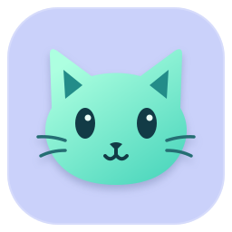

<p align="center">
  
</p>
<h1 align="center">ClashGo</h1>
<p align="center">Your configuration. Your rules. Subscriptions are just node pools.</p>
<p align="center">
  
  
  
  
</p>
<p align="center"><strong>English</strong> · <a href="README.zh-CN.md">简体中文</a></p>

ClashGo is a native Linux desktop proxy client built with **Go, [MyGo](https://github.com/egoist/mygo), [Onevra](https://github.com/oneo-me/onevra), and [mihomo](https://github.com/MetaCubeX/mihomo)**. It uses a native UI, not an Electron shell or embedded webview. The core runs as a supervised sidecar process.

**Status:** release candidate, tested on CachyOS x86-64 with Hyprland. Other Linux desktops and architectures need independent validation. This is an independent third-party project, not affiliated with MetaCubeX or Shadowrocket. The badge names the candidate tag; it does not promise that a hosted release or packaged download is already available.

## A different configuration model

- **You own `master.yaml` and your named profiles.** Subscription updates do not replace your rule configuration.
- **Subscriptions supply nodes, not policies.** Subscription `proxy-groups` are discarded at ingestion; supported leaf selections are flattened into ordinary nodes while required dialer chains are retained.
- The rendered configuration exposes the single application-owned selector **`节点选择`**. Subscription policy-group cards are intentionally absent.
- Managed pools are validated and rendered as local file providers. Invalid downloads preserve the previous valid pool.
- Runtime-only settings are applied during rendering: mixed/controller ports and authentication, TUN MTU **1500**, IPv6 disabled when unspecified, a DNS listener when TUN is enabled, and direct rules for subscription server domains. Explicit master IPv6 settings are respected.

ClashGo is not a drop-in host for arbitrary subscription group hierarchies or another client's merge/script pipeline.

## Features

- Native dashboard, light/dark themes, node selection and latency tests, connection/request views, rules, profiles, DNS observations, and core logs.
- Separate cat application and tray artwork. The tray is colored when capture readiness checks pass and gray otherwise; this is **not** a guarantee that every remote site or node is reachable.
- System-proxy integration through `gsettings`, with ownership fingerprints to avoid overwriting another application's changes.
- TUN mode with launch-permission checks and verification of the applied configuration, listener, and actual network interface—not just `/version` availability.
- Validated configuration edits and profile/settings changes, staged publication, and rollback on ordinary activation failures.
- One instance per configuration directory, managed background tasks, stale-result rejection, and cancellable diagnostic requests.
- Manual subscription refresh plus a 24-hour scheduler, duplicate-request coalescing, and exponential failure backoff.
- Immediate capture-status publication at startup; outbound IP/organization lookup does not hold the core-operation lock. Fixed-name startup timing milestones help diagnose delays without logging credentials.

## Build and run

### Requirements

- **Go 1.27.3** or a compatible newer toolchain; versions are pinned in [`go.mod`](go.mod).
- A Linux graphical session with **GTK 3**, a session D-Bus, and **libayatana-appindicator3** for the tray. Package names vary by distribution. A tray host is required to display the icon.
- **mihomo**, installed separately and available on `PATH` or selected in settings. The current integration suite was validated against **v1.19.33**. The core and geodata are not bundled.
- Network access on first dependency/core-data download, or an already populated local cache. `GOPROXY=off` does not download missing dependencies.

The current UI uses MyGo **v0.9.1** and Onevra **v0.2026.18**. Native mode does not require WebKitGTK or Node.js. SVG-to-PNG regeneration additionally uses `rsvg-convert`; the generated PNGs are already tracked.

```bash
# From the repository root; fetch dependencies once if needed.
go mod download

# Reproducible dependency selection, using the populated module cache.
GOPROXY=off go build -o /tmp/clashgo ./cmd/clashgo

# Run in your normal desktop session, not as root.
/tmp/clashgo
```

Building into `/tmp` avoids adding a binary to the source tree. To install manually, **quit the existing application first**, preserve a rollback copy if applicable, then:

```bash
install -Dm755 /tmp/clashgo "$HOME/.local/bin/clashgo"
install -Dm644 assets/icon.svg \
  "$HOME/.local/share/icons/hicolor/scalable/apps/clashgo.svg"
"$HOME/.local/bin/clashgo"
```

This installs the executable and icon, not a desktop entry, system service, core, or privileged helper. There is no bundled installer or automatic updater in this candidate.

### First use and routing

1. Start ClashGo and select the mihomo executable if it cannot be discovered.
2. Add a subscription/node pool or import local nodes. Configure your own rules in the profile editor.
3. Select a node and choose system-proxy or TUN capture as appropriate.
4. Check actual connectivity. A listening port or successful controller request alone is not enough.

Default endpoints are **`127.0.0.1:7897`** for HTTP/SOCKS and **`127.0.0.1:9097`** for the authenticated controller. The application generates the controller secret; do not publish settings, subscription URLs, or rendered runtime files.

System proxy settings are only honored by applications that use them. Other software may need an explicit proxy, for example:

```bash
https_proxy=http://127.0.0.1:7897 curl --max-time 15 https://example.com/
```

TUN needs administrator-approved permissions for mihomo. The desktop application itself should not run as root. A launcher with `NoNewPrivs: 1` can prevent core file capabilities from taking effect; use a normal authorized desktop launch and diagnose the permission error rather than bypassing sandbox restrictions. This candidate has no general-purpose privilege broker.

## Data and safety

| Default location | Purpose |
|---|---|
| `~/.config/clashgo/master.yaml` | User-owned base profile |
| `~/.config/clashgo/profiles/` | Named profiles |
| `~/.config/clashgo/settings.json` | App settings and controller secret |
| `~/.config/clashgo/subscriptions.json` | Application-owned subscription registry |
| `~/.local/state/clashgo/runtime/` | Rendered configuration, provider caches, core data |
| `~/.local/state/clashgo/logs/` | Logs |

`XDG_CONFIG_HOME` and `XDG_STATE_HOME` override the corresponding roots. **Do not hand-edit `subscriptions.json` while ClashGo is running.** Back up user profiles separately from generated runtime files. Treat all subscription/configuration exports as potentially sensitive.

## Validation

```bash
GOPROXY=off go test ./... -count=1
GOPROXY=off go vet ./...

# Optional real-core integration coverage; core cases otherwise skip.
CLASHGO_TEST_MIHOMO=/usr/bin/mihomo \
  GOPROXY=off go test -race ./... -count=1
```

Functional UI experiments must use separate XDG directories, unused ports, synthetic credentials, and TUN disabled. Use a private D-Bus session and `GSETTINGS_BACKEND=memory` so a test cannot take over the desktop proxy. Do not use a live user profile as a fixture.

## Known boundaries

- Multi-file publication rolls back ordinary errors; it is **not crash-atomic** across source files, registry, provider caches, settings, and a running core.
- DNS observations are derived from core logs, not a complete structured DNS event stream. Resolver identity does not establish direct/proxy routing.
- Automatic subscription refresh currently uses a fixed 24-hour interval. There is no per-subscription schedule UI.
- On the tested host, UU accelerator sessions conflict with gVisor TUN. Turn TUN off for UU; automatic coexistence is not implemented.
- Native GTK/portal warnings remain in some environments. Other desktops, accessibility, packaging, backup/sync, and broad protocol compatibility need further testing.
- There is no kill-switch guarantee, WebDAV/SubStore integration, universal URL-scheme import, or bundled self-updater.

[`AUDIT.md`](AUDIT.md) records the engineering audit, implemented work, measurements, and remaining risks. Older documents in `docs/` are historical design/validation notes, not authoritative current installation instructions.

## License and acknowledgements

ClashGo is licensed under **GPL-3.0**; see [`LICENSE`](LICENSE). Dependencies and the separately installed mihomo core retain their own licenses. Thanks to MyGo, Onevra, mihomo, and the open-source Go ecosystem. The cat application/tray artwork is maintained in [`assets/`](assets/).
