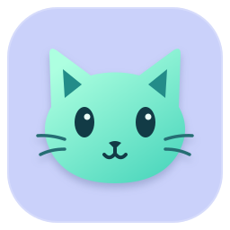

<p align="center">
  
</p>
<h1 align="center">ClashGo</h1>
<p align="center">配置归你，规则归你，订阅只提供节点。</p>
<p align="center">
  
  
  
  
</p>
<p align="center"><a href="README.md">English</a> · <strong>简体中文</strong></p>

ClashGo 是使用 **Go、[MyGo](https://github.com/egoist/mygo)、[Onevra](https://github.com/oneo-me/onevra) 和 [mihomo](https://github.com/MetaCubeX/mihomo)** 构建的 Linux 原生桌面代理客户端。不使用 Electron 外壳或内嵌 WebView，mihomo 以受管理的子进程运行。

**当前状态：**候选发布版，已在 CachyOS x86-64 / Hyprland 上验证；其他 Linux 桌面和架构仍需独立验证。本项目是独立第三方客户端，与 MetaCubeX、Shadowrocket 无隶属关系。版本徽标对应候选标签，不代表已经有线上 Release 或打包下载。

## 配置与订阅各司其职

- **`master.yaml` 和命名配置归用户所有。** 更新订阅不会用订阅规则覆盖你的主配置。
- **订阅只提供节点，不接管策略。** 订阅中的 `proxy-groups` 在入库时整段丢弃；支持的叶子选择被拍平成普通节点，必要的拨号链路保留。
- 运行配置只提供应用自有的 **`节点选择`** 组；界面刻意不展示订阅策略组卡片。
- 应用托管的节点池经校验后以本地文件 provider 提供；下载内容无效时保留上一次有效节点池。
- 渲染时强制应用混合端口、控制器地址与鉴权设置，TUN MTU 固定为 **1500**；未指定 IPv6 时关闭，显式设置则尊重；TUN 开启时确保 DNS 监听存在，并为订阅服务器域名添加直连规则。这些都是运行配置处理，不会直接改写用户源文件。

ClashGo 不以兼容任意订阅策略组层级或其他客户端的合并脚本体系为目标。

## 已有功能

- 原生概览仪表盘、浅色/深色主题、节点选择与测速、连接/请求视图、规则、配置、DNS 观察和内核日志。
- 应用与托盘使用独立的猫猫图标资源。接管就绪检查通过时托盘彩色，否则灰色；**不等于所有远端网站或节点均可用**。
- 基于 `gsettings` 的系统代理接管与恢复，通过完整指纹识别所有权，避免覆盖其他应用的修改。
- TUN 启动权限检查，并验证已生效的配置、端口和真实网卡，而非仅凭 `/version` 可访问就宣告成功。
- 配置编辑、配置切换与设置变更先校验、再暂存发布；普通激活失败时执行回滚。
- 同配置目录单实例、受管理后台任务、过期结果拒绝和可取消的诊断请求。
- 手动更新订阅、24 小时自动更新、重复请求合并和失败指数退避。
- 启动时及时发布已验证的接管状态；出口 IP/组织信息查询不占用内核操作锁。固定名称的启动耗时标记便于定位延迟，不记录凭据。

## 构建与运行

### 环境要求

- **Go 1.27.3** 或兼容的新版本工具链，依赖版本锁定于 [`go.mod`](go.mod)。
- Linux 图形会话、**GTK 3**、会话 D-Bus；托盘需要 **libayatana-appindicator3** 及桌面的托盘宿主。发行版的软件包名称可能不同。
- 单独安装 **mihomo**，放入 `PATH` 或在设置中指定路径。当前集成测试使用 **v1.19.33**；项目不捆绑内核及地理数据。
- 首次下载 Go 依赖和内核数据时需要网络，或提前准备完整缓存。`GOPROXY=off` 不会下载缺失的依赖。

当前使用 MyGo **v0.9.1**、Onevra **v0.2026.18**。原生模式不要求 WebKitGTK 或 Node.js。重新生成 SVG 对应的 PNG 时另需 `rsvg-convert`；生成好的 PNG 已纳入版本管理。

```bash
# 在仓库根目录执行；缺少依赖时先下载一次。
go mod download

# 使用已经填充的模块缓存构建。
GOPROXY=off go build -o /tmp/clashgo ./cmd/clashgo

# 从正常桌面会话运行，不要以 root 身份启动应用。
/tmp/clashgo
```

产物放在 `/tmp`，避免污染源码目录。手动安装时，**先正常退出已有实例**，按需备份旧二进制，再执行：

```bash
install -Dm755 /tmp/clashgo "$HOME/.local/bin/clashgo"
install -Dm644 assets/icon.svg \
  "$HOME/.local/share/icons/hicolor/scalable/apps/clashgo.svg"
"$HOME/.local/bin/clashgo"
```

以上只安装程序和图标，不安装桌面入口、系统服务、内核或特权助手。本候选版没有捆绑安装器或自动更新器。

### 首次使用与流量接管

1. 启动 ClashGo；未自动找到 mihomo 时，在设置中选择内核路径。
2. 添加订阅节点池或导入本地节点，在配置编辑器中维护自己的规则。
3. 选择节点，并按需要使用系统代理或 TUN 接管。
4. 实测网络连通性；仅有监听端口或控制器响应还不够。

默认 HTTP/SOCKS 混合入口为 **`127.0.0.1:7897`**，鉴权控制器为 **`127.0.0.1:9097`**。控制器密钥由应用生成；不要公开设置文件、订阅地址或渲染后的运行配置。

系统代理只影响遵循对应桌面设置的应用；其他程序可能需要显式指定代理，例如：

```bash
https_proxy=http://127.0.0.1:7897 curl --max-time 15 https://example.com/
```

TUN 需要管理员批准的 mihomo 权限，桌面应用本身不应以 root 运行。启动器的 `NoNewPrivs: 1` 可能阻止内核文件能力生效；应从正常、已授权的桌面路径启动并诊断权限错误，不能通过绕过沙箱限制解决。本候选版没有通用特权代理服务。

## 数据与安全边界

| 默认位置 | 用途 |
|---|---|
| `~/.config/clashgo/master.yaml` | 用户主配置 |
| `~/.config/clashgo/profiles/` | 命名配置 |
| `~/.config/clashgo/settings.json` | 应用设置及控制器密钥 |
| `~/.config/clashgo/subscriptions.json` | 应用持有的订阅注册表 |
| `~/.local/state/clashgo/runtime/` | 运行配置、provider 缓存与内核数据 |
| `~/.local/state/clashgo/logs/` | 日志 |

`XDG_CONFIG_HOME`、`XDG_STATE_HOME` 可覆盖相应根目录。**应用运行时不要手工编辑 `subscriptions.json`。** 用户配置应独立于生成的运行文件备份；所有订阅/配置导出都应视为可能含有敏感信息。

## 验证

```bash
GOPROXY=off go test ./... -count=1
GOPROXY=off go vet ./...

# 可选真实内核集成测试；未设置此变量时相应测试会跳过。
CLASHGO_TEST_MIHOMO=/usr/bin/mihomo \
  GOPROXY=off go test -race ./... -count=1
```

功能和 UI 实验必须使用独立 XDG 目录、空闲端口、合成凭据并关闭 TUN。原生 UI 测试还应使用私有 D-Bus 与 `GSETTINGS_BACKEND=memory`，避免接管真实桌面的系统代理。不得拿日常配置当测试夹具。

## 已知边界

- 多文件发布支持普通错误回滚，**不保证崩溃原子性**；源文件、注册表、provider 缓存、设置及运行中的内核不构成一个完整事务。
- DNS 观察基于内核日志解析，不是完整的结构化 DNS 事件流；解析器地址不能证明直连/代理路径。
- 自动订阅更新目前固定为 24 小时，没有逐订阅调度界面。
- 测试主机上 UU 加速会话与 gVisor TUN 冲突；使用 UU 时需关闭 TUN，未实现自动共存切换。
- 部分环境仍有 GTK/portal 警告；其他桌面、无障碍、发行打包、备份同步及广泛协议兼容性仍需测试。
- 不提供断网保护保证、WebDAV/SubStore 集成、通用 URL 协议导入或捆绑自更新器。

[`AUDIT.md`](AUDIT.md) 保留审计、实施记录、测量结果与遗留风险。`docs/` 中的早期材料是历史设计/验证记录，不是当前安装说明的权威来源。

## 许可证与致谢

ClashGo 使用 **GPL-3.0** 许可证，见 [`LICENSE`](LICENSE)。依赖及单独安装的 mihomo 内核保留各自许可证。感谢 MyGo、Onevra、mihomo 与 Go 开源生态；猫猫应用/托盘图标源文件位于 [`assets/`](assets/)。
